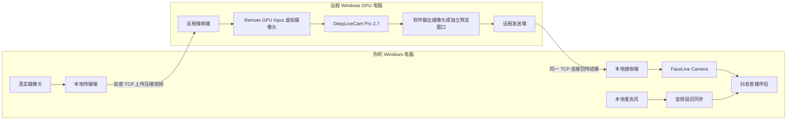

# 远程 GPU 换脸方案

调研日期：2026-11-02（Asia/Shanghai）。当前版本：**0.3.1，只填服务器地址 + 一个 Key**。独立本地端 / 服务器端，支持窗口结果采集，无需修改换脸软件。本机 TLS / H.264 传输、原画回环、原生窗口采集已验证；公网 4090 两机视频与 Pro 2.7 的真实窗口仍需联调。

## 先运行

- **当前先看 [0.3.1 地址与单 Key 连接](docs/09-地址与单Key连接.md)**。服务器开放一个 TCP 端口，不需要 Tailscale、账号或额外配对码。
- 完整发布目录为 `dist/0.3.1/RemoteGpu/`；不要从压缩包中直接运行 EXE，先完整解压。
- 本地运行 `RemoteGpuLocal.exe`，服务器运行 `RemoteGpuServer.exe`。两个独立界面，没有切换角色的标签页；配置各自保存。
- 暂时没有服务器时，先运行 `预览YY画面.cmd`；或在本地端选“YY开播”，点“仅本地预览”，不需要地址、密钥或 Tailscale。
- 服务器先“启动接收”，点“复制 Key”；本地只填服务器地址和 Key，点“启动推送”。服务器选择“原画回环”，预览后“开始回传”验证网络，再选择真实结果窗口。
- 本版支持 720p 横 / 竖屏，H.264 软件编解码；不含换脸软件和模型。1080p 与 NVENC 属于下一阶段。
- 用户已开通 **4090 24 GB / Windows Server 2022**。环境报告确认旧版可启动与 GPU 识别；新版完整视频桥接仍需上机验证。

## 推荐方案

在本地和远程 Windows GPU 电脑各运行一个视频传输端。远程运行用户指定的 **DeepLiveCam Pro 2.7**，同时试单图换脸和 DFM；本地接收处理结果，通过现有 `FaceLive Camera` 输出到抖音直播伴侣。

当前默认使用同一条加密 TCP 连接上传与回传。接收、采集结果和回传可以分别控制。本地等待回传不会因“服务器尚未开始回传”而自动断开。原 WebRTC / Tailscale 方式保留在命令行，不占据新界面的主流程。

**默认采集换脸软件的独立结果窗口；也可读取结果虚拟摄像头。** 服务器输入使用 `FaceLive Camera #2`，本地直播输出使用 `FaceLive Camera`。窗口采集支持 Windows Graphics Capture 与 PrintWindow 兼容方式、裁切边距；采集失败不会自动转为采集桌面。

这里的“远程电脑本地运行换脸软件”，指软件安装在租用的 GPU 电脑上。如果换脸软件仍在家里的电脑运行，就没有把这部分推理交给租用的 GPU。

## 已核实的版本结论

- DeepLiveCam Pro 与 hacksider 的 Deep-Live-Cam / 2.7 Ultimate 是不同产品，不能混用功能和 CUDA 要求。
- Pro 2.7 的配套指南明确介绍 DFM：现代界面使用 `onclick_run_qt6.bat`，DFM 放在 `models\dfm`。这是文档证据，实际安装包和具体 DFM 仍需上机验收。
- 官网现有下载会随版本更新；必须记录实际安装包版本与 SHA-256，不能把文件名相同当成仍然是 2.7。

证据、发布渠道与尚未验证的部分见 [版本调研](docs/01-版本调研.md)。

## 网速先看这张表

以下为 H.264、单路视频、30 FPS 的**设计起点**，不是软件实测或抖音规定码率。竖屏 720×1280 与横屏 1280×720 像素量相同。

| 档位 | 上传给远程的目标视频码率 | 远程回传的目标视频码率 | 本地稳定可用上传建议 | 本地稳定可用下载建议 |
|---|---:|---:|---:|---:|
| 720p / 30 FPS | 3–5 Mbps | 4–6 Mbps | ≥20 Mbps | ≥15 Mbps |
| 1080p / 30 FPS | 6–10 Mbps | 8–12 Mbps | ≥30 Mbps | ≥25 Mbps |

本地上传建议已经考虑“原视频上传给远程 + 直播伴侣向平台推流”的同时占用与余量。远程服务器建议实测上下行各有至少 50 Mbps 可用容量，先验证 720p，再考虑 1080p。

**100M / 500M / 1000M 宽带通常描述下载档位，不能据此推断上传速度。** 测试应在实际直播时段进行，使用有线网络，并观察到目标机房的延迟和丢包。

详细公式、流量费用估算和延迟目标见 [带宽与延迟](docs/03-带宽与延迟.md)。

## 租用方向

优先找距离近、可按小时试用、带完整 Windows 11 桌面和管理员权限的 GPU 云电脑。建议先用 RTX 4090 24 GB 做单图 / DFM 对照测试，再根据实测降低配置。4090 是方便同时测试多种负载的候选，不保证所有 DFM 都能达到 30 FPS。

租机需要允许安装虚拟摄像头、持续运行桌面程序和使用 GPU 视频编码；只有 Linux Notebook 或只有 TCP 端口映射的算力容器不适合作为本方案的默认环境。

## 文件索引

| 文件 | 内容 |
|---|---|
| [版本调研](docs/01-版本调研.md) | Pro 2.7、DFM、发行版区别、来源证据 |
| [技术方案](docs/02-技术方案.md) | 双端职责、免改软件桥接、媒体与网络、现有项目复用 |
| [带宽与延迟](docs/03-带宽与延迟.md) | 720p / 1080p 预算、上传叠加、Mbps 与 MB/s、流量计费 |
| [租机与验收](docs/04-租机与验收.md) | 选机条件、分阶段实施、需要记录的实测数据 |
| [原型使用说明](docs/05-双端原型使用说明.md) | 本地端 / 远程端操作、摄像头和网络部署 |
| [验证记录](docs/06-原型验证记录.md) | 自动化与打包测试结果、待联调项目 |
| [免账号公网直连](docs/07-免账号公网直连.md) | 0.2.0 推荐流程、单 TCP 端口、配对码 |
| [独立双端与窗口采集](docs/08-独立双端与窗口采集.md) | 0.3.0 当前流程、独立启停、IP 与 Key、窗口裁切 |
| [地址与单 Key 连接](docs/09-地址与单Key连接.md) | 0.3.1 当前连接流程：地址 + Key，无需配对码 |

客户端、服务器端、部署脚本和测试均归入本目录。发布包内两个独立入口共用运行库，配置相互隔离。额外的 `RemoteGpu.exe` 保留给诊断命令和旧脚本；换脸软件和模型需在 GPU 服务器另外安装，本包不包含它们。
